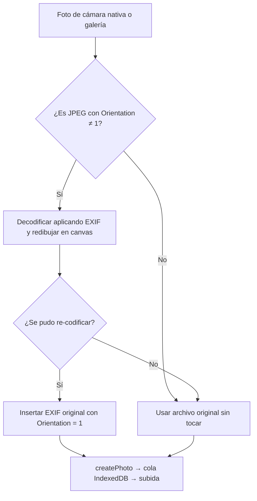

# STI-Cam — Plan de desarrollo

Estado: Nivel 11/11 (desplegado en v1.18.2; falta prueba en celular) · Última actualización: 2026-10-29

> Proyecto existente. Este plan cubre el ajuste en curso; los niveles 1–3 van comprimidos.

## Cambio actual: miniaturas de lado (orientación EXIF)

### 1. Misión
- Problema: las fotos tomadas en vertical salen de lado en las miniaturas (cuadrícula de la app, `=IMAGE()` en Sheets y Looker Studio), aunque la foto completa se ve bien en Drive y en el visor de la app.
- Causa: la cámara nativa guarda los píxeles en horizontal y una etiqueta EXIF `Orientation` (6/8/3). Los visores la aplican; las miniaturas que genera Google no.
- Para quién / dónde: residentes de obra, celular (Android/iOS) en la PWA, a veces sin conexión.
- Cómo debe funcionar: antes de guardar la foto en la cola, la app endereza los píxeles y deja `Orientation = 1`, conservando el resto del EXIF (GPS, fecha, cámara).
- Fuera de alcance: corregir fotos ya subidas (se evaluará como script aparte); cambiar el formato de la hoja.
- Terminado cuando: una foto vertical nueva se ve derecha en la cuadrícula de la app, en Sheets y en Looker Studio, y sigue teniendo su EXIF (fecha/GPS) en Drive.

### 2. Diseño (flujo)

Pantallas: sin cambios visibles. Cualquier fallo cae al archivo original (nunca se pierde una foto).

### 3. Arquitectura
- Stack: el mismo (React + Vite PWA). **Sin dependencias nuevas**: el EXIF se copia y parchea a mano (segmento APP1, etiqueta 0x0112).
- Despliegue: el mismo (GitHub Pages vía `pnpm deploy`).
- Datos: sin cambios; la foto corregida sigue el flujo IndexedDB → Drive → Sheets.
- Capas:
  - Infraestructura: nuevo `src/infrastructure/ImageOrientation.js` → `normalizeOrientation(blob): Promise<Blob>` (leer orientación, rotar en canvas, re-inyectar EXIF).
  - Interfaz: `CameraScreen.jsx` (captura nativa) y `HomeScreen.jsx` (importar de galería) llaman a `normalizeOrientation` antes de `createPhoto`.
- Coste: una re-compresión JPEG (calidad 0.95) solo en fotos que lo necesitan.

### 6. Reglas y validaciones
| Regla | Caso límite | Resultado esperado |
|---|---|---|
| Solo se procesa JPEG con EXIF y Orientation 2–8 | Orientation = 1 o sin EXIF (PNG, HEIC, foto ya derecha) | Se devuelve el mismo blob, sin re-comprimir |
| Si el navegador no aplicó el EXIF al decodificar | Orientation 5–8 y el ancho decodificado = ancho original | Se sube la original (no se “hornea” la foto de lado) |
| Cualquier error (memoria, canvas, archivo corrupto) | Excepción en decodificar o codificar | Se sube la original y se registra en el Logger |
| El EXIF se conserva | GPS, fecha, marca | Igual que en la original; Orientation = 1; miniatura EXIF desvinculada |

### 10. Pruebas — 3/3 superadas (Node, APIs del navegador simuladas)
- JPEG 400×300 con Orientation 6 + GPS + fecha → sale 300×400, Orientation 1, GPS/fecha/marca intactos. ✅
- JPEG sin rotación → se devuelve el mismo objeto sin tocar. ✅
- `vite build` sin errores. ✅
- Pendiente: prueba real en celular (Android e iPhone) y revisar la miniatura en Sheets.

### 11. Entrega
- Versión: 1.18.2 · Publicado en GitHub Pages con `pnpm deploy`.
- Mantenimiento: si Google empieza a respetar el EXIF en miniaturas, este paso sigue siendo inofensivo.

## Registro de decisiones
- 2026-10-29 — Corregir la orientación en el cliente antes de subir — `IMAGE()`/Looker no permiten rotar y las miniaturas de Google ignoran el EXIF.
- 2026-10-29 — Parchear EXIF a mano en vez de usar `piexifjs` — evitar dependencia por un cambio de un solo campo.
- 2026-10-29 — `allowBuilds` de `@firebase/util` y `protobufjs` en `false` — sus postinstall no hacen falta en el navegador y los marcadores pendientes bloqueaban `pnpm build`.
